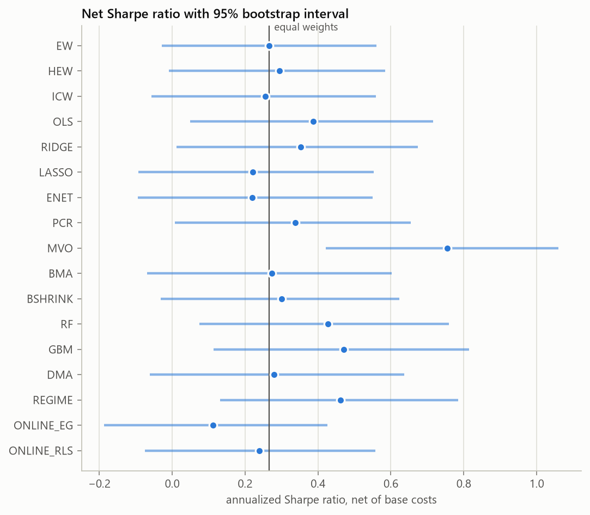
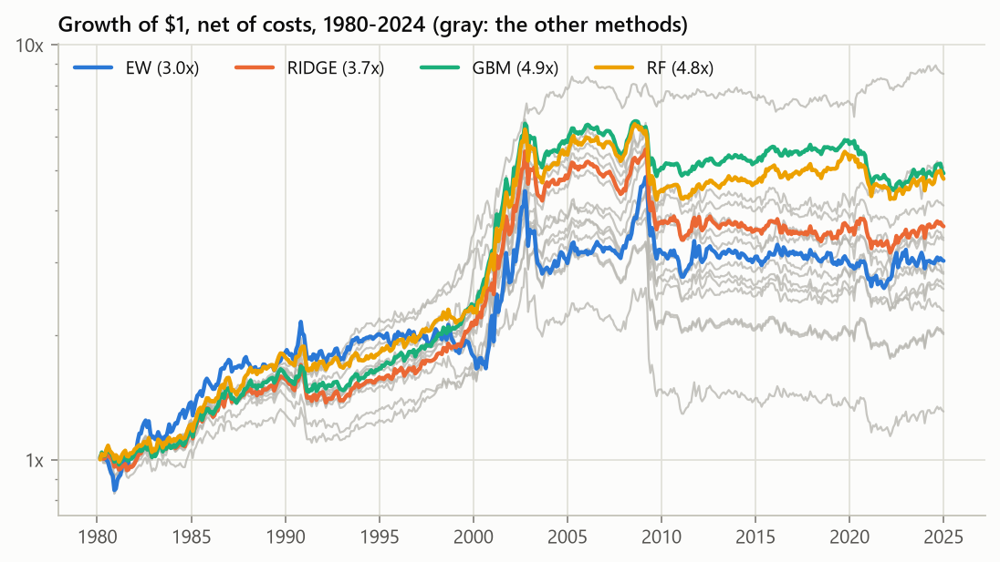
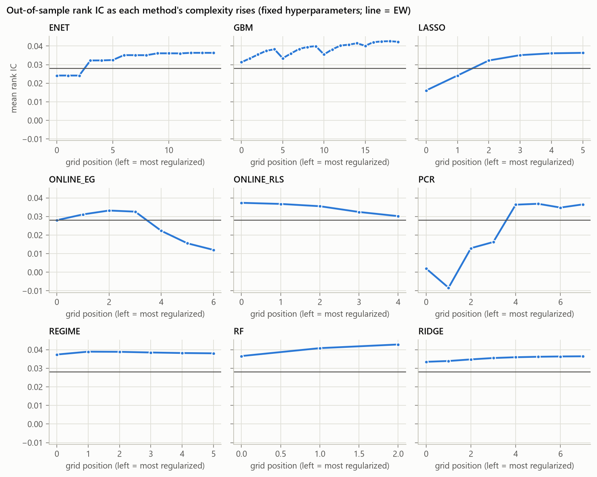
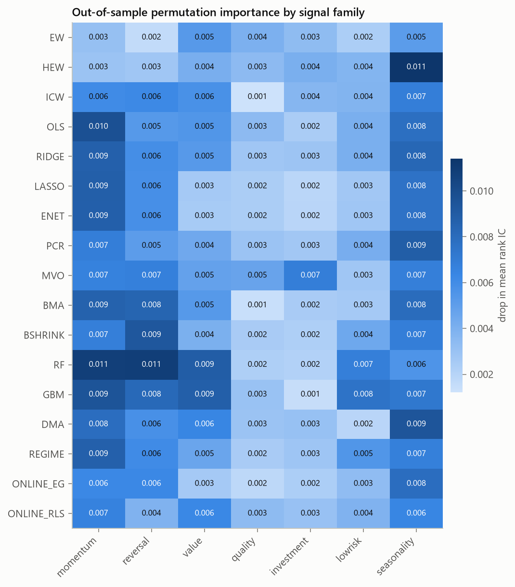
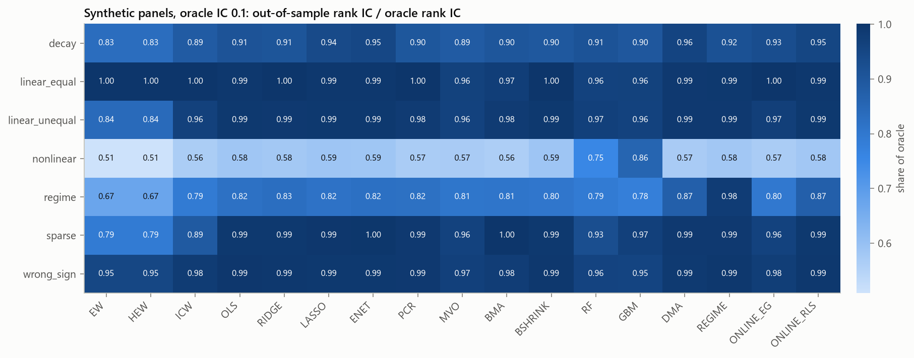

# Combining sixteen equity signals: does complexity pay?

**A pre-registered, out-of-sample comparison of seventeen ways to combine noisy, correlated return signals in the
S&P 500, 1980-2024.**

Every number in this report is produced by the code in this repository. The protocol, hypotheses and decision rule
were committed to git (`f924c95`, `experiments/preregistration.md`) before any return-based statistic was
computed. A second test, adding analyst and options signals (section 9), was pre-registered the same way (`0a0ce07`,
`experiments/preregistration_extension.md`). Tables are in `reports/tables/`, generated text in
`reports/results.md`, `reports/exploratory.md` and `reports/extension.md`.

## Summary

1. **By the pre-registered decision rule, no complex method beats equal weighting.** None of the fourteen complex
   methods improves on equal weights (EW) with a Holm-adjusted p-value below 5%, for net Sharpe ratio or for rank
   information coefficient (IC).
2. **Complex models do forecast slightly better.** Random forests raise the mean monthly rank IC from 0.028 to 0.042
   (difference t = 2.8). Gradient boosting reaches 0.040, linear regression 0.037. Dependence-aware corrections
   (Romano-Wolf p = 0.045; Hansen's SPA test for the best complex method p = 0.013) accept the forest's gain. The
   more conservative Holm correction does not (p = 0.09). The gain vanishes when only published signals are used
   (real time), with rolling ten-year windows, and after 2015.
3. **Better forecasts do not become better portfolios after costs.** Complex methods trade about twice as much as
   EW (10.6-13.5 times the book a year against 6.2). Their net Sharpe gains (+0.1 to +0.2) are not significant.
4. **The best portfolio was a mean-variance mix of the signals, and the reason is not prediction.** Signal mean-
   variance (MVO) earned a net Sharpe of 0.75 against EW's 0.27. Exploratory checks show this came from the
   covariance of the signal portfolios, not from forecasting their returns: a minimum-variance mix that assumes
   every signal earns the same does as well. Most of it was also market exposure: EW carries a market beta of about
   -0.3 to -0.5 from its low-risk signals. **Hedged against the market ex ante, EW's net Sharpe is 0.78 and no
   method beats it.** MVO reaches 0.76; lasso, BMA, Bayesian shrinkage and the online learners do worse.
5. **Complexity curves split in two.** More flexibility in the cross-sectional mapping helped: less shrinkage
   (ridge, lasso, elastic net) and deeper trees raised out-of-sample IC, because decades of data across 500 stocks
   estimate sixteen weights well. More flexibility over time hurt: faster forgetting and larger learning rates
   lowered IC, and dynamic model averaging and the regime ensemble added nothing over a pooled regression.
6. **Sixteen correlated signals behave like about ten.** Regressions and MVO give the 52-week-high signal a
   negative weight. That signal is 58% correlated with momentum and adds nothing on its own, so it is used to hedge
   momentum, against its published sign.
7. **All signals faded.** EW's rank IC fell from 0.037 (1980-99) to 0.004 (2015-24). After 2015 no method's net
   Sharpe is distinguishable from zero (best 0.26, MVO, against a sampling error of about ±0.6 over ten years).
8. **The machinery can find complexity when it exists.** On synthetic panels with a known truth and an oracle IC
   of 0.10, trees recover 75-86% of a non-linear signal (linear models 58%), the regime ensemble 98% of a
   regime-switching one, and regressions beat EW whenever the true weights are unequal. At an oracle IC of 0.03,
   closer to the real data, most of these advantages shrink to the noise across seeds.
9. **Leakage is measurable.** Shuffled K-fold cross-validation overstated validation IC by about 0.02 against
   forward-chaining validation (t = 2.4-3.4 across the nine tuning dates). That is about half the realized IC.
10. **More, and more different, signals did not change the answer (second pre-registered test).** Four I/B/E/S
    analyst signals raised equal weighting's rank IC by about a third in 1990-2024 (+0.006, raw p = 0.03, Holm
    p = 0.06). With three OptionMetrics signals added as well, the effective number of independent signals rose
    from 10 to 14. No complex method beat equal weights on the richer sets, raw or market-hedged. After 2004, five
    estimated linear methods did significantly worse than hedged equal weights.

Bottom line for a portfolio manager: with a handful of published large-cap signals, spend the effort on the
covariance structure, on risk (market exposure) and on trading costs, not on a more flexible forecasting model.
Equal weighting by family and a market hedge get most of the way.

---

## 1. Question and design

Given a collection of imperfect, partly correlated alpha signals, how should a portfolio manager combine them? The
goal is better out-of-sample forecasts and portfolios, not better in-sample fit. The study tests seventeen methods
against equal weighting under one walk-forward protocol fixed in advance:

| Experiment | What it asks | Hypotheses |
|---|---|---|
| E1 synthetic | Can each method find the truth when we know it? (positive controls) | as pre-registered |
| E2 main | Do complex methods beat equal weights out of sample, after costs? | H1-H4, H7 |
| E3 robustness | Rolling windows, one-standard-error rule, quintiles, high costs, subperiods | secondary |
| E4 leakage | How much do shuffled or purged cross-validation flatter the validation score? | H9 |
| E5 real time | What if a signal can be used only after its publication year? | H8 |
| E6 complexity | Out-of-sample performance along every method's complexity grid; PBO | H5, H6 |
| X1-X3 | Exploratory, decided after seeing E2 (labelled as such) | none |

**Decision rule (pre-registered).** "A complex method beats equal weighting" only if some complex method has a
positive difference with Holm-adjusted p < 0.05 in H1 (net Sharpe) or H2 (rank IC) **and** Hansen's SPA test of
the best complex method rejects at 5% for the same metric.

## 2. Data

- **Universe.** S&P 500 members at each month end (CRSP `msp500list`), not yet delisted, with a market cap: 492-506
  stocks a month, 1967-2024. Returns include delisting returns, with the Shumway (1997) fill where CRSP has none,
  booked in the month the holder receives them. The monthly build matches an earlier independent build of the same
  tables on every count (635,141 rows, 1,218 delisting returns booked, 215 rows appended for them).
- **Fundamentals.** Compustat annual, linked through the CCM table; a fiscal year is usable from the end of the
  sixth month after its year end, for at most 18 months.
- **Daily data.** CRSP daily files for volatility, beta, the 52-week high and dollar volume; Fama-French factors from
  Kenneth French's library.
- **Sample.** Panel from 1967-01 (all signals have five years of history). Forecasts are formed 1980-01 to 2024-11:
  **539 out-of-sample months**, each earning the following month's return.
- **Not in this repository.** CRSP and Compustat are licensed: the code rebuilds everything from WRDS. Only
  portfolio-level results are published.

## 3. Signals

Each signal is delivered through one interface (`signals/base.py`) as records with eight fields: instrument,
timestamp, horizon, value, confidence, historical observations, data provenance and model version (a hash of the
code that produced it). Signals are plugins (`signals/registry.py`); a vendor file in the record format enters
through `ExternalSignal` with no code change. Each month every signal is ranked, mapped to normal scores, multiplied
by its published sign; a missing value is set to 0 (neutral).

| Signal | Family | Sign | Definition | Reference |
|---|---|---|---|---|
| MOM | momentum | + | return over months t-11..t-1 | Jegadeesh & Titman (1993) |
| IMOM | momentum | + | 6-month value-weighted FF48 industry return | Moskowitz & Grinblatt (1999) |
| HIGH52 | momentum | + | price / 52-week high | George & Hwang (2004) |
| STREV | reversal | - | return in month t | Jegadeesh (1990) |
| LTREV | reversal | - | return over months t-59..t-12 | De Bondt & Thaler (1985) |
| BM | value | + | log book-to-market (current price) | Rosenberg, Reid & Lanstein (1985) |
| EP | value | + | earnings / price | Basu (1977) |
| CFP | value | + | cash flow / price | Lakonishok, Shleifer & Vishny (1994) |
| GPA | quality | + | gross profits / assets | Novy-Marx (2013) |
| ROA | quality | + | earnings / assets | Haugen & Baker (1996) |
| ACC | quality | - | balance-sheet accruals | Sloan (1996) |
| AG | investment | - | asset growth | Cooper, Gulen & Schill (2008) |
| NSI | investment | - | 12-month net share issuance | Pontiff & Woodgate (2008) |
| IVOL | lowrisk | - | idiosyncratic volatility (FF3, 1 month, daily) | Ang, Hodrick, Xing & Zhang (2006) |
| BETA | lowrisk | - | 12-month daily market beta | Frazzini & Pedersen (2014) |
| SEAS | seasonality | + | same-calendar-month return, past 5 years | Heston & Sadka (2008) |

Coverage is 93-100% of universe rows from the 1970s (accruals 80-89%). Signals from earnings revisions, options
markets, alternative data and macro forecasts were not available in this data set; the interface accepts them, and
macro state enters through the regime variables.

**Correlation structure.** The average within-month rank correlation (oriented by sign) is low overall (0.03) but
clustered: EP-CFP 0.76, GPA-ROA 0.65, MOM-HIGH52 0.58, BM-CFP 0.61, and value against quality BM-GPA -0.53. The
**effective number of independent signals is 10.0** (eigenvalue participation ratio) of 16; the first principal
component carries 19% of the variance.

## 4. Methods

All methods learn the same target (next month's return as within-month normal scores) from the same sixteen
signals. Grids are ordered from the most to the least regularized model.

| Method | Idea | Tuned over |
|---|---|---|
| EW | equal weights | - |
| HEW | equal weight per family, then within the family | - |
| ICW | weights proportional to trailing rank IC (negatives set to 0) | - |
| OLS | pooled linear regression | - |
| RIDGE | L2 penalty | lambda (8 values) |
| LASSO | L1 penalty | lambda (6) |
| ENET | elastic net | lambda x mixing (15) |
| PCR | regression on the first k principal components | k (8) |
| MVO | mean-variance weights on the signal portfolios, Ledoit-Wolf covariance | - |
| BMA | Bayesian model averaging over all 2^16 subsets, g-prior, effective sample size | - |
| BSHRINK | empirical-Bayes shrinkage of Fama-MacBeth slopes toward equal weights | - |
| RF | random forest (LightGBM) | depth (3) |
| GBM | gradient boosting (LightGBM) | depth x rounds (20) |
| DMA | dynamic model averaging over all family subsets (Raftery et al. 2010) | - (lambda = alpha = 0.99) |
| REGIME | regime-specific regressions shrunk to the pooled one | kappa (6) |
| ONLINE_EG | multiplicative weights on cumulative IC (Hedge) | eta (7) |
| ONLINE_RLS | recursive least squares with forgetting | forgetting factor (5) |

Two details matter. Pooled rows are not independent (common monthly shocks): the design effect, measured as the
ratio of Fama-MacBeth to naive pooled-OLS coefficient variance, is about 3, so BMA and DMA use rows/3 as their
effective sample. And every linear method works from per-month sufficient statistics, so cross-validation is cheap
and exact.

## 5. Protocol

- **Walk-forward, expanding window.** Parameters re-estimated every January on every formation month whose outcome
  is known by then, minus a one-month embargo. Hyperparameters re-selected every five years by **nested**
  forward-chaining validation inside the training window (three 36-month blocks), criterion mean rank IC.
- **Online methods** also learn each month's outcome as soon as it is known.
- **Portfolio.** Rank-weighted dollar-neutral long-short, $1 long and $1 short, rebalanced monthly; turnover
  accounts for drift.
- **Costs.** One-way cost = era base (50 bp before May 1975, 30 bp to 1990, 15 bp in the 1990s, 5-9 bp after
  decimalization) x a liquidity multiplier from trailing dollar volume. The schedule sits below Jones (2002), whose
  measure of half-spread plus commission for large US stocks averages 0.84% over 1925-2000 and stays below 0.5%
  after 1991 (retail-like commissions). It is an assumption: results are also shown at twice the costs and as
  break-even multiples. Capacity uses a square-root impact model (one day's execution, coefficient 1).
- **Guards.** Transforms never cross months. A test perturbs every signal and return dated after a cut-off and
  checks that no earlier forecast moves, for all seventeen methods. The registry logs every run before it starts.

## 6. Results

### 6.1 Every method, 1980-2024 (E2)

| Method | Rank IC (t) | Gross Sharpe | Net Sharpe [95%] | Net, 2x costs | Turnover / yr | 7-factor alpha (t) |
|---|---|---|---|---|---|---|
| EW | 0.028 (4.2) | 0.42 | 0.27 [-0.03, 0.56] | 0.11 | 6.2 | +0.1% (0.1) |
| HEW | 0.032 (4.8) | 0.53 | 0.29 [-0.01, 0.58] | 0.06 | 9.2 | +0.2% (0.2) |
| ICW | 0.033 (5.5) | 0.53 | 0.26 [-0.06, 0.56] | -0.02 | 9.9 | -0.9% (-0.9) |
| OLS | 0.037 (6.5) | 0.77 | 0.39 [0.05, 0.72] | 0.00 | 12.0 | -0.7% (-0.8) |
| RIDGE | 0.036 (6.2) | 0.71 | 0.35 [0.01, 0.67] | -0.01 | 11.4 | -0.5% (-0.5) |
| LASSO | 0.032 (5.9) | 0.62 | 0.22 [-0.09, 0.55] | -0.18 | 12.4 | -0.8% (-0.9) |
| ENET | 0.032 (5.9) | 0.62 | 0.22 [-0.09, 0.55] | -0.18 | 12.4 | -0.8% (-0.9) |
| PCR | 0.035 (6.0) | 0.70 | 0.34 [0.01, 0.65] | -0.03 | 11.3 | -1.1% (-1.2) |
| MVO | 0.037 (7.7) | 1.23 | **0.75 [0.42, 1.06]** | 0.27 | 10.7 | +1.4% (1.4) |
| BMA | 0.034 (6.1) | 0.67 | 0.27 [-0.07, 0.60] | -0.12 | 12.5 | -1.9% (-2.1) |
| BSHRINK | 0.035 (6.3) | 0.73 | 0.30 [-0.03, 0.62] | -0.13 | 13.5 | -1.6% (-1.8) |
| RF | **0.042 (7.7)** | 0.81 | 0.43 [0.07, 0.76] | 0.05 | 12.1 | +0.2% (0.2) |
| GBM | 0.040 (7.5) | 0.91 | 0.47 [0.11, 0.81] | 0.02 | 12.6 | +0.5% (0.5) |
| DMA | 0.035 (5.4) | 0.61 | 0.28 [-0.06, 0.64] | -0.05 | 11.0 | -0.1% (-0.1) |
| REGIME | 0.037 (6.6) | 0.86 | 0.46 [0.13, 0.78] | 0.06 | 11.8 | +0.5% (0.5) |
| ONLINE_EG | 0.029 (4.8) | 0.42 | 0.11 [-0.19, 0.43] | -0.20 | 10.6 | -0.5% (-0.5) |
| ONLINE_RLS | 0.033 (5.5) | 0.59 | 0.24 [-0.07, 0.56] | -0.12 | 11.6 | -0.2% (-0.2) |

Rank IC t-statistics are Newey-West. Intervals are stationary block bootstraps (mean block 6 months, 5,000 draws).
Alpha is the annualized intercept on market, size, value, profitability, investment, momentum and short-term
reversal factors; every method's net return is 31-71% explained by them (R^2), EW's 71%.





Each signal alone (same portfolio rule) earns at most a net Sharpe of 0.40 (net share issuance, rank IC 0.019,
t = 4.4), then gross profitability (0.30) and asset growth (0.28). Short-term reversal, seasonality and
idiosyncratic volatility have high ICs but turn over 10-16 times a year and lose money after costs. Every
combination beats most single signals, which is the case for combining at all.

### 6.2 The primary tests (H1, H2) and the decision rule

| Method | Net Sharpe minus EW [95%] | p | Holm p | Romano-Wolf p | Rank IC minus EW (t) | Holm p | Romano-Wolf p |
|---|---|---|---|---|---|---|---|
| HEW | +0.03 [-0.04, 0.09] | 0.38 | 1.00 | 0.81 | +0.0040 (2.76) | 0.09 | **0.045** |
| OLS | +0.12 [-0.09, 0.35] | 0.28 | 1.00 | 0.67 | +0.0085 (1.81) | 0.84 | 0.23 |
| RIDGE | +0.09 [-0.12, 0.30] | 0.43 | 1.00 | 0.81 | +0.0080 (1.92) | 0.71 | 0.20 |
| MVO | +0.49 [0.14, 0.82] | 0.007 | 0.12 | **0.035** | +0.0089 (1.37) | 1.00 | 0.39 |
| RF | +0.16 [-0.06, 0.39] | 0.17 | 1.00 | 0.53 | +0.0142 (2.76) | 0.09 | **0.045** |
| GBM | +0.20 [-0.05, 0.47] | 0.12 | 1.00 | 0.43 | +0.0118 (2.18) | 0.41 | 0.12 |
| REGIME | +0.19 [-0.07, 0.48] | 0.16 | 1.00 | 0.56 | +0.0090 (1.68) | 0.93 | 0.27 |
| BMA | +0.01 [-0.23, 0.25] | 0.96 | 1.00 | 1.00 | +0.0060 (1.16) | 1.00 | 0.48 |
| DMA | +0.01 [-0.28, 0.36] | 0.94 | 1.00 | 1.00 | +0.0065 (0.98) | 1.00 | 0.56 |
| ONLINE_EG | -0.16 [-0.39, 0.10] | 0.23 | 1.00 | 0.62 | +0.0009 (0.20) | 1.00 | 0.86 |

(All sixteen comparisons are in `reports/tables/tests_vs_ew.csv`; the omitted ones are smaller.)

**Decision.** No complex method reaches Holm p < 0.05 on either metric, so by the pre-registered rule **no complex
method beats equal weighting**. Two results sit just under the bar and are reported as such. MVO's net Sharpe gain
is accepted by Romano-Wolf (which uses the dependence between tests). The forest's IC gain is accepted by
Romano-Wolf, and by the SPA test below. No method is significantly worse than EW either.

### 6.3 Secondary hypotheses

- **H3 (SPA, best of the complex methods vs EW).** On rank IC the best method (RF) beats EW once the search over
  fourteen methods is accounted for: consistent p = 0.013. On mean net returns the best (MVO) does not: p = 0.34.
  MVO's advantage is lower risk, not higher mean return, and an SPA on raw returns does not reward lower risk (see
  X3).
- **H4 (deflated Sharpe ratio).** MVO's net Sharpe of 0.75, deflated for every real-data configuration tried, has
  a DSR of 0.964 with the 144 confirmatory trials. Counting the three exploratory variants as well (147 trials),
  it falls to 0.947, just below 0.95: the registry makes repeated experimentation cost something. The trials'
  returns are highly correlated (mean pairwise 0.71, effective number 1.8); with that effective number the DSR is
  1.00. The DSR asks whether MVO's Sharpe is above zero after selection, not whether it beats EW.
- **H5 (probability of backtest overfitting).** Over the 78 fixed configurations of E6 (12,870 CSCV splits), PBO
  is 0.02: choosing a configuration in one half of the sample rarely picks a below-median one in the other half,
  and the in-sample best never lost money out of sample. Hyperparameter search is not where overfitting hides here.
- **H6 (complexity).** Along each grid (Spearman correlation of grid position with out-of-sample rank IC):

  | Ridge | Lasso | Elastic net | PCR | Random forest | Boosting | Regime | Online RLS | Online EG |
  |---|---|---|---|---|---|---|---|---|
  | +1.00 | +1.00 | +0.95 | +0.86 | +1.00 | +0.91 | -0.14 | -1.00 | -0.68 |

  Less shrinkage and deeper trees always helped: sixteen weights are well estimated from ~350,000 stock-months
  (about 120,000 effective). More adaptivity always hurt. The nested selection agreed: it chose the least
  regularized ridge, lasso and PCR settings most often.

  

- **H7 (regimes).** The regime ensemble does not beat its pooled counterpart: rank IC +0.0005 over OLS (t = 0.20).
- **H8 (real time).** If each signal enters only from January of its publication year, EW's rank IC is 0.017 and
  its net Sharpe 0.15 (hindsight EW: 0.27; difference 0.11 [-0.05, 0.31], p = 0.23). No method beats real-time EW
  (smallest Holm p 0.07, for HEW, which is *worse*). Trees still forecast a little better (+0.006 to +0.008 IC,
  not significant).
- **H9 (leakage).** Inner-validation optimism (selected configuration's validation IC minus the next five years'
  realized IC), averaged over nine tuning dates:

  | Method | Forward-chaining | Purged K-fold (12-month embargo) | Shuffled K-fold |
  |---|---|---|---|
  | RIDGE | 0.013 | 0.031 | 0.034 |
  | ENET | 0.017 | 0.030 | 0.034 |
  | GBM | 0.015 | 0.029 | 0.035 |

  Shuffled minus forward: +0.017 to +0.021 (t = 2.4-3.4). The pre-registered order holds. Purging helps but does not
  remove the optimism, because twelve months of embargo cannot hide five-year signals (long-term reversal,
  seasonality) or regime knowledge. Realized IC barely differs across schemes: leakage inflates the estimate more
  than it changes the choice.

### 6.4 When it worked: subperiods and regimes

| | 1980-1999 | 2000-2014 | 2015-2024 |
|---|---|---|---|
| EW net Sharpe (rank IC) | 0.36 (0.037) | 0.31 (0.032) | 0.01 (0.004) |
| MVO | 1.07 (0.056) | 0.74 (0.030) | 0.26 (0.009) |
| RF | 0.66 (0.057) | 0.44 (0.039) | 0.06 (0.016) |
| GBM | 0.72 (0.055) | 0.54 (0.037) | -0.06 (0.012) |
| REGIME | 0.66 (0.054) | 0.44 (0.030) | 0.24 (0.015) |
| DMA | 0.91 (0.062) | 0.03 (0.017) | -0.14 (0.005) |

Every method's edge decays, consistent with the post-publication decline of anomaly returns (McLean & Pontiff
2016). Rankings of methods are only moderately stable across the three periods (Kendall's W = 0.43). The adaptive
methods (DMA, online learners) did best in the first period and worst afterwards.

Complex methods' IC advantage over EW was largest after market declines (trailing two-year market return negative:
MVO +0.030, GBM +0.027, RF +0.026) and in high-volatility months, but negative during NBER recessions (-0.001 to
-0.020 for every method except HEW). See `reports/tables/regimes.csv`.

### 6.5 Stability and what the models use

- **Weights.** Linear weights barely move between annual refits (correlation 0.98-1.00; 0.91-0.94 for PCR, DMA,
  REGIME and online RLS).
- **Hyperparameters do move.** The selected configuration changed at 25% (forest) to 88-100% (boosting, elastic
  net, regime, multiplicative weights) of the five-yearly tunings. Boosting picked 50 rounds of depth-5 trees most
  often; in hindsight, 200 rounds would have earned a net Sharpe of 0.66 instead of 0.47. That gap is the cost of
  choosing without knowing the future, which the protocol charges.
- **Negative weights from correlation.** OLS gives momentum the largest weight (0.15-0.17 of the absolute total)
  and the 52-week high a negative one (-0.05 to -0.09), against its published sign. MVO spreads weight more evenly,
  shorts the 52-week high (down to -0.11) and gives market beta about nothing.
- **Importance (out-of-sample permutation, by family).** Trees lean on momentum, reversal, value and low risk;
  quality and investment matter least to the regressions and the trees (not to EW or MVO).

  

### 6.6 Costs, capacity and factor exposures

- Complex methods turn over 11-13.5 times a year, EW 6.2. At twice the base costs every method except EW (0.11) and
  MVO (0.27) has a net Sharpe near or below zero. Break-even cost multiples: EW 2.7, MVO 2.5, others 1.4-2.2.
- Capacity is small for these monthly full-universe books. With square-root impact, net returns reach zero at
  roughly $10-30 million for every method, in 1980-1999 (thin markets: the median member traded about $3 million a
  day in the 1980s) and in 2010-2024 (when there was no gross return left to pay for trading). Cost-aware
  construction and slower signals would raise this; the comparison of methods does not depend on it.
- Every combination is mostly known factors: EW's net return loads on profitability (0.48), momentum (0.33), value
  and investment (0.20 each) and the market (-0.29), with R^2 0.71 and no alpha.

### 6.7 Robustness (E3)

- **Rolling ten-year windows.** Most gains vanish: trees and regressions land within ±0.07 of EW's net Sharpe. Only
  MVO stays ahead (+0.37, p = 0.07). Shorter windows hurt the estimated models.
- **One-standard-error rule** (pick the simplest configuration within one standard error). Lower net Sharpe for
  most tuned methods; boosting's IC gain survives (+0.011, raw p = 0.04).
- **Equal-weighted quintile portfolios.** Same ranking: MVO 0.74, GBM 0.49, RF 0.40, EW 0.29.

## 7. Exploratory analyses (decided after seeing E2; not pre-registered)

**X2: what drives MVO.** All variants use the same protocol:

| Variant | Uses | Rank IC | Net Sharpe | Minus EW (p) |
|---|---|---|---|---|
| MVO | means + Ledoit-Wolf covariance | 0.037 | 0.75 | +0.49 (0.003) |
| MINVAR | covariance only (equal expected returns) | 0.030 | 0.76 | +0.50 (0.001) |
| MVO_SAMPLE | means + unshrunk covariance | 0.036 | 0.88 | +0.61 (0.001) |
| RISKPAR | volatilities only (no correlations) | 0.029 | 0.44 | +0.18 (<0.001) |

The covariance of the signal portfolios does the work: knowing that value and momentum hedge each other, that the
low-risk signals are volatile, and so on. Estimated means add nothing. Inverse-volatility weights, which ignore
correlations, capture about a third of the gain.

**X1: hedge the market.** Each method's net return minus an ex-ante market hedge (beta from its previous 36 months),
1983-2024:

| | EW | HEW | MINVAR | MVO | GBM | RF | RIDGE | OLS | BMA | BSHRINK | LASSO | ONLINE_EG |
|---|---|---|---|---|---|---|---|---|---|---|---|---|
| Net Sharpe, unhedged | 0.26 | 0.30 | 0.78 | 0.79 | 0.49 | 0.44 | 0.36 | 0.40 | 0.30 | 0.31 | 0.23 | 0.11 |
| Net Sharpe, hedged | **0.78** | 0.81 | 0.85 | 0.76 | 0.69 | 0.68 | 0.68 | 0.63 | 0.48 | 0.47 | 0.41 | 0.46 |

EW has a full-period market beta of -0.47 (its low-risk signals short high-beta stocks in a rising market). Once
that is hedged, **equal weights is as good as anything**: no method improves on it significantly (hedged
differences -0.37 to +0.07). Lasso, elastic net, BMA, Bayesian shrinkage and both online learners do worse (raw p = 0.009-0.03, Holm
p = 0.14-0.32).

**X3: a Sharpe-consistent SPA.** Scaling every method to the same ex-ante volatility before the SPA test makes its
mean comparison a Sharpe comparison. The best complex method (MVO) then beats EW: consistent p = 0.038. X1 shows
what that advantage is made of.

## 8. Synthetic positive controls (E1)

Seven worlds with a known truth, two signal strengths (oracle IC 0.03 and 0.10), three seeds each; 300 stocks, 30
years, the same protocol. Out-of-sample rank IC as a share of the oracle's (average of three seeds):

| World | Oracle IC | EW | OLS | RIDGE | BMA | RF | GBM | DMA | REGIME | ONLINE_RLS |
|---|---|---|---|---|---|---|---|---|---|---|
| all signals equal | 0.10 | 1.00 | 0.99 | 1.00 | 0.97 | 0.96 | 0.96 | 0.99 | 0.99 | 0.99 |
| unequal weights | 0.10 | 0.84 | 0.99 | 0.99 | 0.98 | 0.97 | 0.96 | 0.99 | 0.99 | 0.99 |
| sparse | 0.10 | 0.79 | 0.99 | 0.99 | 1.00 | 0.93 | 0.97 | 0.99 | 0.99 | 0.99 |
| one wrong sign | 0.10 | 0.95 | 0.99 | 0.99 | 0.98 | 0.96 | 0.95 | 0.99 | 0.99 | 0.99 |
| non-linear | 0.10 | 0.51 | 0.58 | 0.58 | 0.56 | 0.75 | **0.86** | 0.57 | 0.58 | 0.58 |
| regime switches | 0.10 | 0.67 | 0.82 | 0.83 | 0.81 | 0.79 | 0.78 | 0.87 | **0.98** | 0.87 |
| half the signals decay | 0.10 | 0.83 | 0.91 | 0.91 | 0.90 | 0.91 | 0.90 | **0.96** | 0.92 | 0.95 |
| all signals equal | 0.03 | **1.01** | 0.91 | 0.99 | 0.77 | 0.89 | 0.79 | 0.84 | 0.90 | 0.90 |
| non-linear | 0.03 | 0.47 | 0.48 | 0.50 | 0.51 | 0.53 | 0.52 | 0.48 | 0.46 | 0.46 |
| regime switches | 0.03 | 0.73 | 0.76 | 0.80 | 0.62 | 0.69 | 0.53 | 0.70 | 0.81 | 0.73 |

Every pre-registered positive control passes at IC 0.10: the right tool wins in the world it was built for. At IC
0.03 the advantages shrink to the differences between seeds (standard deviation of the ratio 0.1-0.2), and the
flexible methods (BMA, boosting, DMA) lose most when the truth is simple. The real data, with combined rank ICs of
0.03-0.04, look like the second half of this table. The full grid is in `reports/tables/synthetic_ratio.csv`.



## 9. A second pre-registered test: analyst and options signals

The main study leaves an obvious objection: sixteen price- and accounting-based signals that behave like about ten
may simply be too similar for a flexible model to find anything equal weighting misses. A second pre-registration
(`experiments/preregistration_extension.md`, commit `0a0ce07`), written after the main results but before any
return statistic of the new signals was computed, adds signals from two other information sources:

| Signal | Source | Sign | Definition |
|---|---|---|---|
| REV1 | I/B/E/S | + | one-month change in the mean FY1 EPS forecast / price (Chan, Jegadeesh & Lakonishok 1996) |
| REVB | I/B/E/S | + | (upward - downward FY1 revisions) / number of estimates, at least 3 |
| SUE | I/B/E/S | + | latest quarterly surprise, actual minus last median forecast, / price (Livnat & Mendenhall 2006) |
| DISP | I/B/E/S | - | standard deviation / abs(mean) of FY1 forecasts (Diether, Malloy & Scherbina 2002) |
| IVSKEW | OptionMetrics | - | 30-day implied volatility, delta -20 put minus delta +50 call (Xing, Zhang & Zhao 2010) |
| IVSPREAD | OptionMetrics | + | 30-day implied volatility, delta +50 call minus delta -50 put (Cremers & Weinbaum 2010) |
| VRP | OptionMetrics | + | realized volatility in month t minus at-the-money 30-day implied volatility (Bali & Hovakimian 2009) |

The unadjusted I/B/E/S files are used, because the standard files restate history for stock splits after the CRSP
data end: per-share values are divided by the same-date CRSP price, and a value is left blank when CRSP shows a
split inside the window it depends on. Analyst signals cover 88-99% of the S&P 500 universe from 1985 (SUE 92-95%
from 1990), option signals 98-100% from 2000 (`reports/data_integrity_extension.md`, written before any return
statistic). The new signals are partly new information. Forecast revisions correlate 0.28-0.31 with momentum and the
52-week high, and forecast dispersion 0.23-0.33 with the low-risk and profitability signals. The volatility premium
correlates -0.42 with idiosyncratic volatility, and the two skew signals are nearly uncorrelated with all sixteen
(|rho| <= 0.12). The effective number of independent signals rises from 10.0 (the sixteen, 1996 onward) to 11.7
with the analyst signals (1985 onward) and 14.1 with both (1996 onward).

Each extended set is compared with the sixteen on the same months, with the main protocol (two changes for the
shorter samples, applied to both runs: at least 84 training months and 24-month inner validation blocks):

| Window | Signals | Out of sample | Months |
|---|---|---|---|
| A | the sixteen + four analyst = 20 | 1990-01 to 2024-11 | 419 |
| B | the twenty + three options = 23 | 2004-01 to 2024-11 | 251 |

All 68 runs (17 methods x 4 configurations) completed and are in the registry. Full output:
`reports/extension.md` and `reports/tables/ext_*.csv`.

**H10: the new signals add a little forecasting power to equal weights, and no return.**

| Window | EW rank IC, 16 -> extended | Difference (NW t; Holm p) | EW net Sharpe, 16 -> extended (p) | Market-hedged (p) |
|---|---|---|---|---|
| A, 1990-2024 | 0.018 -> 0.024 | +0.0056 (2.18; 0.059) | 0.17 -> 0.18 (0.88) | 0.69 -> 0.66 (0.69) |
| B, 2004-2024 | 0.013 -> 0.017 | +0.0048 (1.42; 0.156) | 0.08 -> 0.12 (0.62) | 0.44 -> 0.54 (0.36) |

The analyst signals raise equal weighting's rank IC by about a third (raw p = 0.029, just above 5% after Holm over
the two windows). None of it reaches net or hedged returns.

**H11: no complex method beats equal weights on the extended sets.** In window A the largest net Sharpe gain over
extended EW is MVO's (0.79 against 0.18, +0.61; raw p = 0.013, Holm p = 0.21, volatility-scaled SPA p = 0.26),
followed by REGIME (+0.30), GBM (+0.29) and OLS (+0.28; Holm p >= 0.23). The largest rank IC gain is the random
forest's (0.035 against 0.024; t = 2.18, Holm p = 0.47; SPA p = 0.052). In window B every complex method is below
extended EW on both metrics (net Sharpe -0.02 to -0.36, rank IC -0.003 to -0.016; SPA p = 1.0). The decision rule is
not met in either window.

**H12: hedged against the market, equal weights is again as good as anything, and after 2004 better.** In window
A, MVO's 0.79 becomes 0.54 hedged against EW's 0.66 (as in the main study, much of its gain is market exposure;
against seven factors it keeps an alpha of 2% a year, t = 2.0, which is not part of the decision rule). No complex
method's hedged Sharpe differs from EW's significantly (differences -0.29 to +0.02, Holm p = 1.0). In window B, OLS,
ridge, lasso, elastic net and BMA have significantly lower hedged Sharpe ratios than EW (differences -0.51 to
-0.64, Holm p = 0.010-0.024). Boosting, the random forest and the recursive least-squares learner are -0.45 to
-0.67 (Holm p = 0.07-0.08).

**Did richer information help the complex methods more than equal weights? No.** Comparing each method's gain over
EW in the extended run with its gain in the sixteen-signal run (descriptive): the rank IC edge shrank for 11 of the
14 complex methods in both windows. The net Sharpe gap moved slightly toward the complex methods (-0.01 to +0.17),
not enough to change any conclusion.

**What the models used.** Permutation importance (the drop in out-of-sample rank IC when one family's values are
shuffled across stocks within a month): in window A the earnings family matters most for 16 of the 17 methods
(HEW, which caps each family's weight, leans on seasonality). In window B the options family matters most for 9 of
the 14 complex methods, but adds little to EW (0.0009 against 0.0065 for earnings). The estimated models leaned on
the options signals and still forecast worse than EW.

**Subperiods** (descriptive; the main study's boundaries, cut to each window). The complex methods' advantage is
again concentrated early. In window A in 1990-99 most estimated methods reach a net Sharpe ratio near or above 1.0
(MVO 1.68) against EW's 0.28. From 2015 the best is REGIME at 0.30 against EW's 0.06, inside a sampling error of
about +-0.6. In window B only MVO (0.27) and REGIME (0.20) edge past EW (0.19) in 2004-14, and in 2015-24 every
method is between -0.32 and +0.05.

Window B's 251 months give little power (the pre-registration noted that it detects only about 1.3 times larger
Sharpe differences than the main study), so its null on H11 alone is weak evidence. But its point estimates all
favour equal weights, and the hedged results in both windows match the main study's.

## 10. What this means

1. **Count your signals honestly.** Sixteen published signals carry about ten independent views; family-level equal
   weighting (HEW) forecasts better than signal-level equal weighting (+0.004 IC, t = 2.8) for that reason alone.
2. **Model the covariance, not the means.** The portfolio gains came from how the signal portfolios co-move. A
   minimum-variance mix needs no return forecasts at all.
3. **Hedge what you did not mean to own.** EW's low-risk signals made it short the market. Removing that exposure
   was worth more than any combination method.
4. **Complexity in the cross-section is cheap and helps a little; complexity over time is expensive and does not.**
   With hundreds of stocks and decades of data, sixteen linear weights are well estimated: shrinkage was
   unnecessary. Signals' payoffs vary over time, but not predictably enough for forgetting factors, regime switches
   or model averaging to track.
5. **Costs and decay decide the economics.** The more flexible the model, the more it trades. After 2015 none of
   the signals, combined any way, paid for its trading.
6. **New information sources are worth adding, but to the simple combination.** Analyst revisions carried real
   information that the price and accounting signals lacked, and equal weighting captured it. Giving the flexible
   methods more, and less correlated, inputs did not give them an edge.

## 11. Limitations

- **Large caps, monthly, sixteen to twenty-three signals.** Machine-learning gains are documented to be larger among
  small stocks and with hundreds of characteristics (Gu, Kelly & Xiu 2020); this study says nothing about that
  setting.
- **Shorter extension windows.** I/B/E/S and OptionMetrics coverage limits the second test to 419 and 251 months.
- **Signal selection has hindsight.** The signals are ones known to have worked. E5 removes signals not yet
  published, but not the bias of publication itself.
- **Costs are an assumed schedule**, not measured trades; capacity uses a stylized impact model and one day of
  execution.
- **Compute limits.** Trees were tuned on small grids every five years (a full random-forest fit on 300,000 rows
  took about a minute on the shared machine). Larger grids could change their results, in either direction.
- **One history.** 539 months is a single path, and the subperiods disagree. Exploratory analyses (X1-X3) are post
  hoc and should be read as explanations, not tests.
- **Early Compustat** (1960s-70s) carries some back-filling; the out-of-sample period starts in 1980.

## 12. Reproducibility

```
python scripts/build_data.py [--pull]        # CRSP/Compustat (WRDS) -> data/processed/
python scripts/build_signals.py              # signal records, panel, data-integrity report
python scripts/run_study.py synthetic        # E1
python scripts/run_study.py main             # E2   (also: robust, leakage, realtime, complexity)
python scripts/run_exploratory.py            # X1-X3
python scripts/analyze_study.py              # tables, figures, results.md, demo data

python scripts/pull_extension.py             # I/B/E/S and OptionMetrics (WRDS) -> data/raw/wrds_ext/
python scripts/build_extension.py            # the seven new signals, panel_ext.parquet, integrity report
python scripts/run_study.py main --config ext_a        # and ext_a_base, ext_b, ext_b_base
python scripts/analyze_extension.py          # reports/extension.md, tables/ext_*, demo summary

pytest                                       # 41 tests; data-dependent checks need the processed files
```

`registry/experiments.jsonl` records every run (config, its hash, git commit, data fingerprint, status, summary):
201 distinct completed real-data configurations (133 for the main study, 68 for the extension), plus the synthetic
development runs. The browser demo's engine is checked against the Python library (`demo/tests.html`: 29 parity
checks, weights and forecasts agree to about 1e-12).

The public history was rewritten on 2026-11-26 (commit messages only; file contents, authors and dates are
unchanged), which gave the first four commits new hashes. The append-only registry keeps the original ones:
`fa240f7` = `f924c95` (pre-registration), `b9bbab5` = `f420780`, `f92dfea` = `6d79b1e`, `fd7edda` = `0a0ce07`
(extension pre-registration).

## 13. Deviations from the pre-registration

1. **Regime definition, before any results.** The volatility regime was first defined against an expanding median.
   Because market volatility trended up after the calm 1960s, that labelled 68% of months "high", so a rolling
   ten-year median was adopted. This happened during the data build, before the pre-registration commit, and is
   recorded in `evaluation/regimes.py`.
2. **Runner fixes with no effect on results.** The main run started from `f924c95` with a change that only ordered
   the jobs (registry: dirty tree). A bug in the synthetic job list made the first synthetic launch fail at start;
   it was fixed and rerun.
3. **Out-of-memory failures.** On the shared machine, two real-time jobs and one robustness pool failed (logged as
   failed in the registry) and were rerun with identical configurations.
4. **The SPA metric for H1.** The pre-registered SPA compares mean net returns, which does not match H1's Sharpe
   metric. Both are reported, and X3 adds the Sharpe-consistent version as an exploratory analysis.
5. **Exploratory analyses X1-X3 and capacity by era** were added after the confirmatory results and are labelled.
   Their runs are counted in the DSR.

Second test (`0a0ce07`):

6. **None in the runs.** All 68 runs started from the pre-registration commit and completed on the first attempt.
   The registry marks the tree as dirty because the registry file is itself tracked and each run appends to it.
7. **The subperiod table** (pre-registered as descriptive) was missing from the first version of
   `scripts/analyze_extension.py` and was added after the confirmatory results, using the main study's boundaries
   cut to each window. The rerun reproduced every other number exactly (all bootstrap seeds are fixed).

## References

Ang, Hodrick, Xing & Zhang (2006), JF. Bailey & López de Prado (2014), Journal of Portfolio Management (deflated
Sharpe ratio). Bailey, Borwein, López de Prado & Zhu (2017), Journal of Computational Finance (PBO). Bali &
Hovakimian (2009), Management Science. Basu (1977), JF. Benjamini & Hochberg (1995), JRSS B. Chan, Jegadeesh &
Lakonishok (1996), JF. Cooper, Gulen & Schill (2008), JF. Cooper, Gutierrez & Hameed (2004), JF. Cremers & Weinbaum
(2010), JFQA. De Bondt & Thaler (1985), JF. DeMiguel, Garlappi & Uppal (2009), RFS. Diether, Malloy & Scherbina
(2002), JF. Fama & French (1992), JF. Frazzini &
Pedersen (2014), JFE. George & Hwang (2004), JF. Grinold & Kahn (2000), Active Portfolio Management. Gu, Kelly & Xiu
(2020), RFS. Hansen (2005), JBES. Haugen & Baker (1996), JFE. Heston & Sadka (2008), JFE. Holm (1979), Scandinavian
Journal of Statistics. Jegadeesh (1990), JF. Jegadeesh & Titman (1993), JF. Jones (2002), working paper, Columbia.
Koop & Korobilis (2012), International Economic Review. Lakonishok, Shleifer & Vishny (1994), JF. Ledoit & Wolf
(2004), Journal of Multivariate Analysis; (2008), Journal of Empirical Finance. Ley & Steel (2009), Journal of
Applied Econometrics. Livnat & Mendenhall (2006), Journal of Accounting Research. López de Prado (2018), Advances in Financial Machine Learning. McLean & Pontiff (2016), JF.
Moskowitz & Grinblatt (1999), JF. Newey & West (1987), Econometrica. Novy-Marx (2013), JFE. Politis & Romano (1994),
JASA. Pontiff & Woodgate (2008), JF. Raftery, Kárný & Ettler (2010), Technometrics. Romano & Wolf (2005),
Econometrica. Rosenberg, Reid & Lanstein (1985), Journal of Portfolio Management. Shumway (1997), JF. Sloan (1996),
The Accounting Review. Xing, Zhang & Zhao (2010), JFQA. Zellner (1986), in Bayesian Inference and Decision Techniques.
